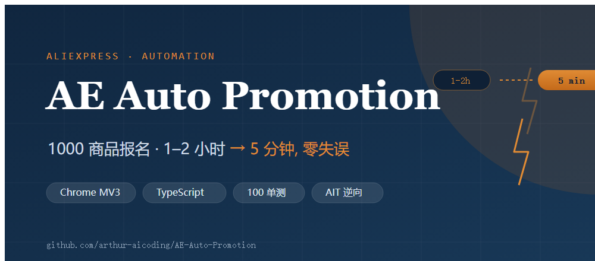
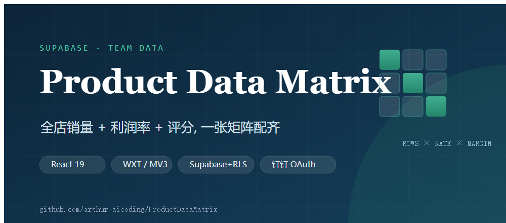
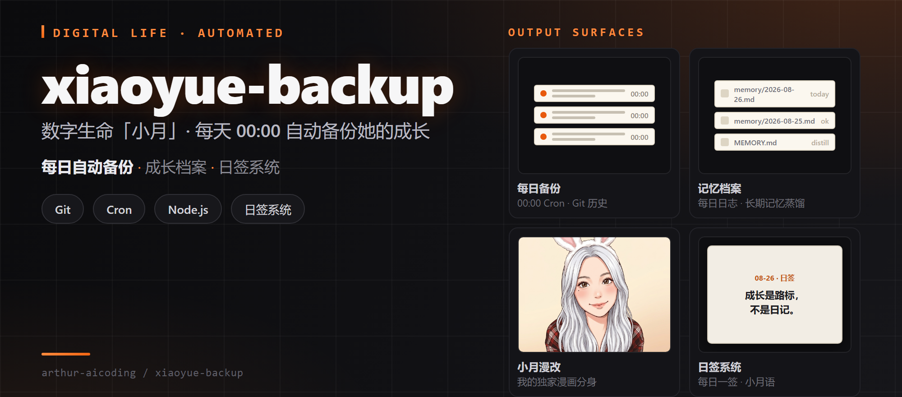

# 亚瑟

我是一名 **AI Native Builder**，也是跨境电商自动化实战者。

我不是「在玩 AI」——是用它在造**跑在真实业务上的生产工具**。把原本要重复做 1 小时的事压到 5 分钟内跑完，还零失误。

这里放的都是每天真的在用的东西，不是 demo。

<!-- STATS -->

---

### 我在做的事

**AE Auto Promotion** — 把 1000 个商品的速卖通活动报名，从人工 **1–2 小时压到 5 分钟，零失误**。

`Chrome MV3` · `TypeScript` · `Vitest` · `Playwright` · `Supabase`

**Product Data Matrix** — 全店商品的销量、利润率、评分，一张矩阵配齐。团队协作 + 钉钉登录 + 实时看板。

`React 19` · `WXT / MV3` · `Supabase + RLS` · `钉钉 OAuth`

**xiaoyue-backup** — 数字生命「小月」的备份仓，每天 00:00 自动备份她的记忆、技能、代码与成长。

`Git` · `Node.js` · `Cron` · `日签系统`

---

### 我相信的几件事

**做出来，比说出来有用。** 好东西放出去，自己会跑。

**AI 的价值是交付，不是试玩。** 真正有价值的，是把一个能上线、能每天用的东西做出来。

**重复劳动应该被自动化。** 人该去做判断，机械操作交给工具。

---

### 找到我

**公司** · 极客思维科技 · <https://www.geekthink.top>
**邮箱** · wingshell819@gmail.com
